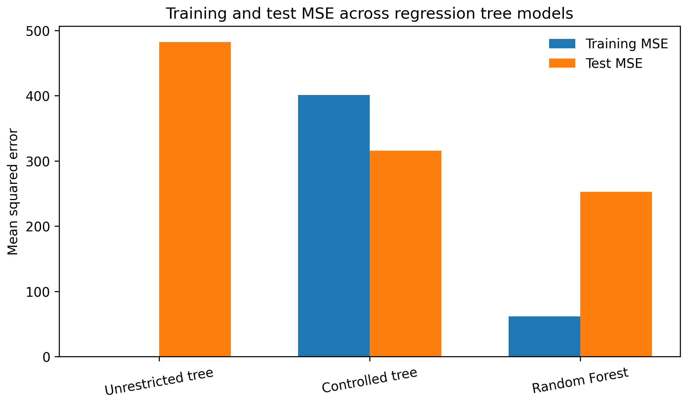
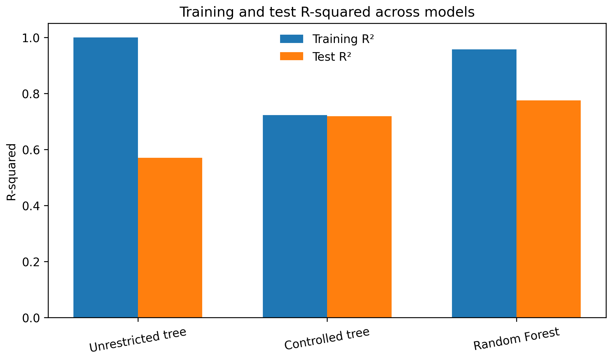
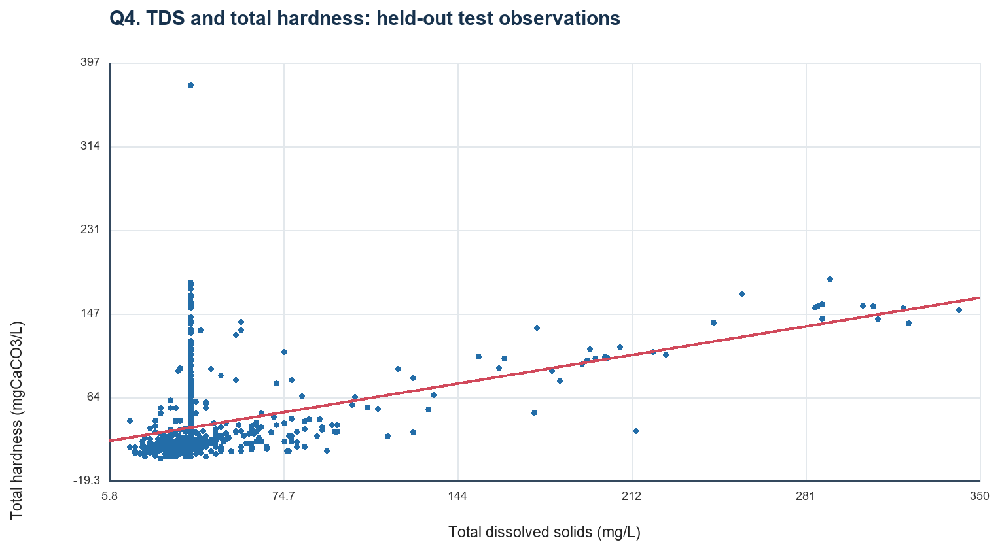
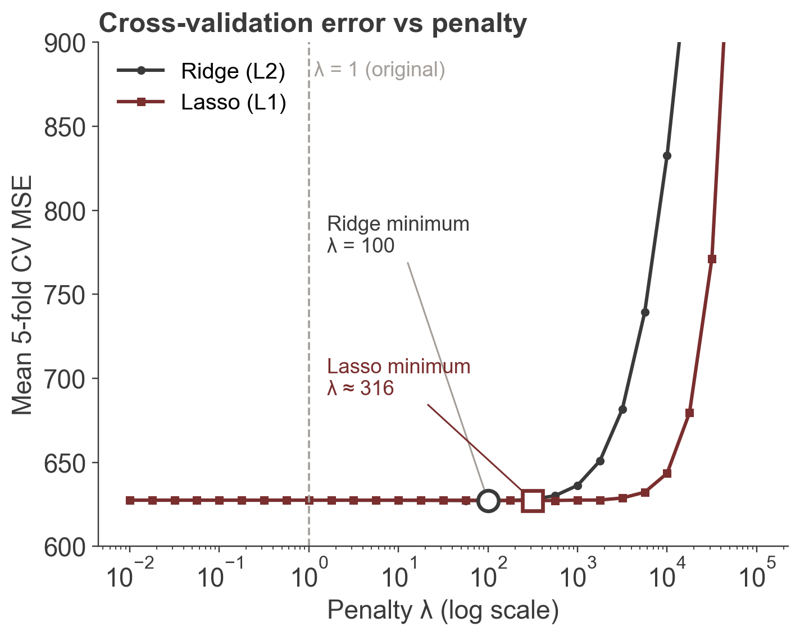
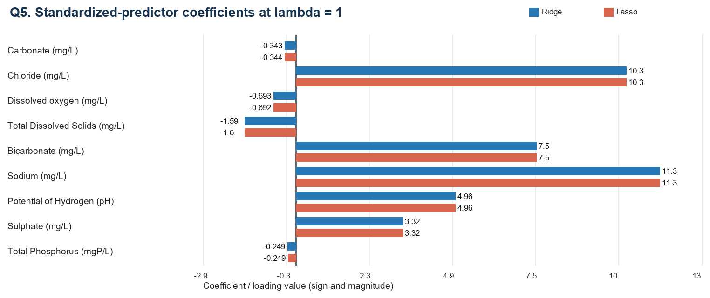
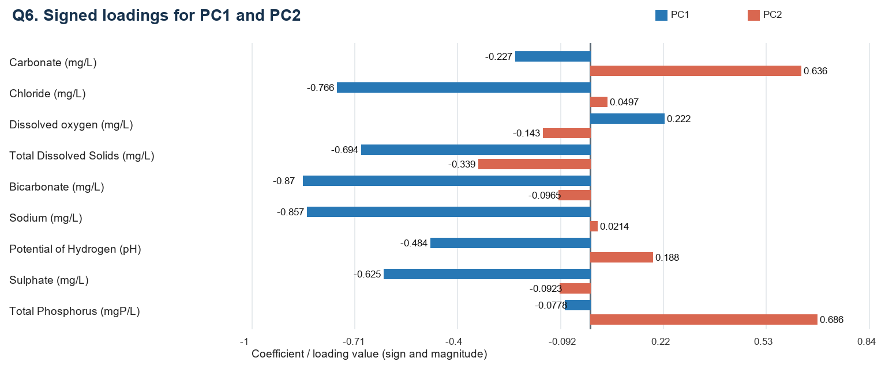
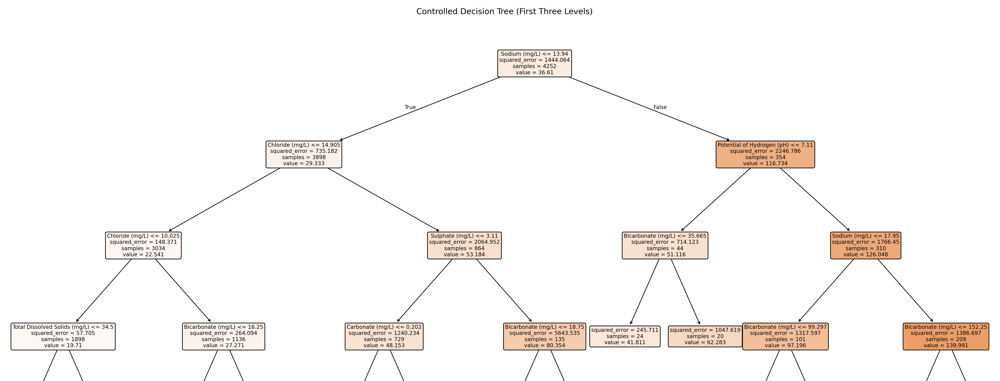
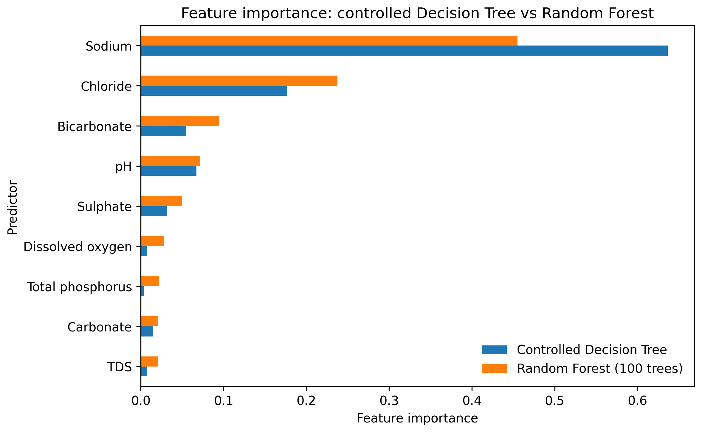

# Predicting River Water Hardness in Kerala with Machine Learning

**Can routine water-chemistry measurements predict water hardness?** This project builds and compares seven
regression models on 40 years of Central Water Commission (CWC) monitoring data from 21 river stations in Kerala, India.
It also includes a statistical assessment of water quality and a study of how missing data affects the analysis.

**Best model: Random Forest. Test R² = 0.775, RMSE = 15.9 mg CaCO₃/L** on 1,064 held-out samples, with test MSE 78% lower
than simply predicting the mean.

📄 **Full report:** [`output/ES225_Assignment3_Group10_Report.pdf`](output/ES225_Assignment3_Group10_Report.pdf)
(32 pages; course project for ES 225 – AI and Data Science, IIT Bombay, Autumn 2026)

---

## Results at a glance

All models predict **total hardness (mg CaCO₃/L)** and are evaluated on the **same held-out test set (n = 1,064)**.

| Model | Predictors | Test MSE | Test RMSE | Test R² |
|---|:---:|---:|---:|---:|
| Baseline (predict the training mean) | – | 1126.67 | 33.57 | – |
| Simple linear regression | TDS only | 884.52 | 29.74 | 0.212 |
| Ridge regression (λ = 100, chosen by 5-fold CV) | 9 | 431.76 | 20.78 | 0.615 |
| Lasso regression (λ ≈ 316, chosen by 5-fold CV) | 9 | 432.07 | 20.79 | 0.615 |
| Lasso regression (λ = 10,000) | **5** | 442.08 | 21.03 | 0.606 |
| Decision Tree, unrestricted | 9 | 482.54 | 21.97 | 0.570 |
| Decision Tree, tuned with 5-fold CV | 9 | 315.64 | 17.77 | 0.719 |
| **Random Forest (100 trees)** | 9 | **252.59** | **15.89** | **0.775** |

<p align="center">
  
  
</p>

**Key takeaways**
- **Non-linear models win.** The tuned tree and the Random Forest beat the best linear model (R² 0.615 → 0.719 → 0.775).
- **Complexity control matters.** An unrestricted tree (depth 36, 3,625 leaves) memorises the training data (training R² = 1.000)
  but generalises worse than linear regression. Tuning it with cross-validation cut test MSE by **34.6%**.
- **Ensembling helps further.** The Random Forest lowers test MSE by another **20%** relative to the tuned tree.
- **Sodium and chloride are consistently the strongest predictors.** They rank top in every tree model, have the largest Ridge/Lasso
  coefficients, and dominate the first principal component.
- **Lasso gives a sparse model almost for free.** With only 5 of 9 predictors it keeps test R² = 0.606, whereas Ridge at the
  same penalty drops to 0.499.

---

## Data

- **Source:** CWC manual chemical water-quality records for Kerala, National Water Data Portal (Government of India)
- **Size:** 5,433 samples, 21 stations on 13 rivers, June 1980 – December 2020, 33 chemical parameters
- **Target:** total hardness (mg CaCO₃/L); 5,316 samples have it recorded
- **Predictors (9):** carbonate, chloride, dissolved oxygen, total dissolved solids (TDS), bicarbonate, sodium, pH, sulphate,
  total phosphorus. Calcium and magnesium were **deliberately excluded**, because hardness is calculated from them and
  including them would leak the answer. Total alkalinity and SAR were excluded as derived measures.

## ML pipeline

```
raw CWC data (5,433 × 52)
  └─ cleaning: drop parameters >80% missing (19 of 33), parse dates, derive season
      └─ drop rows with no target (117) → 5,316 rows
          └─ random 80/20 split, seed 42 → train 4,252 | test 1,064
              ├─ median imputation fitted on TRAIN only → applied to test
              ├─ standardisation fitted on TRAIN only   → (linear models, PCA)
              └─ models fitted on train, evaluated once on test
```

- **No data leakage.** Imputation medians and scaling parameters come from the training set only. The test set is never used
  for model selection.
- **Hyperparameter tuning by 5-fold cross-validation on the training set only.**
  - Decision Tree: `max_depth` ∈ {3, 5, 7, 10, 15, None}, `min_samples_leaf` ∈ {1, 2, 5, 10, 20, 30, 50} and
    `min_samples_split` ∈ {2, 10, 20}. The selected settings were depth 10 and min leaf size 20.
  - Ridge and Lasso: 29 values of λ from 10⁻² to 10⁵, with median imputation and scaling re-fitted inside every fold.
    The selected penalties were λ = 100 (Ridge) and λ ≈ 316 (Lasso).
- **Missing data.** In the full dataset TDS is 65% missing, total phosphorus 48% and DO 32% (TDS: 64% of training rows). Mean, median and
  mode imputation were compared (variance retained: 35–77%). Median imputation was chosen because most parameters are right-skewed.

## Models

### 1. Simple linear regression: hardness ~ TDS
`Hardness = 18.160 + 0.4144 × TDS` (slope 95% CI [0.384, 0.444]), test R² = 0.212. TDS alone captures only a fifth of the
variance. Part of the reason is that 64% of its training values are imputed with a single median; a complete-case fit gives
test RMSE 18.62 instead of 29.74.

<p align="center"></p>

### 2. Ridge and Lasso regression (standardised predictors)

**Choosing λ by cross-validation.** λ was selected by 5-fold CV on the training set over 29 values from 10⁻² to 10⁵.
Imputation and scaling were re-fitted inside every fold, so no validation data leaks into the fit.

| | CV-selected λ | CV MSE | Test MSE | Test R² | Predictors kept |
|---|---:|---:|---:|---:|---:|
| **Ridge** | 100 | 627.2 | 431.76 | 0.615 | 9 |
| **Lasso** | ≈ 316 | 627.2 | 432.07 | 0.615 | 9 |
| **Lasso, one-standard-error rule** | ≈ 17,800 | 679.5 | 460.29 | 0.590 | 5 |

The CV error is flat for every λ up to about 1,000, so only a light penalty helps. With 9 predictors and 4,252 training rows,
ordinary least squares already has low variance, and a stronger penalty mainly adds bias. The one-standard-error rule picks the
largest λ whose CV error is within one standard error of the minimum. It gives a sparser Lasso model (sodium, chloride,
bicarbonate, pH and sulphate) at a small cost in accuracy.

<p align="center"></p>

**Ridge vs Lasso at fixed penalties.**

| | λ = 1 | λ = 1,000 | λ = 10,000 |
|---|---|---|---|
| **Ridge** test R² | 0.615 | 0.612 | 0.499 |
| **Lasso** test R² | 0.615 | 0.615 | 0.606 |
| Predictors Lasso keeps | 9 | 7 (drops carbonate, total P) | 5 (also drops DO, TDS) |

The penalty is applied to the summed squared error over 4,252 rows, so λ ≤ 1 has almost no effect. At large λ the textbook
difference appears: Ridge shrinks every coefficient, while Lasso eliminates the weak predictors and keeps
sodium, chloride, bicarbonate, pH and sulphate almost unchanged.

<p align="center"></p>

### 3. Principal component analysis
On the 9 standardised predictors, PC1 explains 36.6% of the variance and PC2 11.9% (48.4% together); 6 components are needed for 80%.
PC1 is a **dissolved-ion gradient** (bicarbonate −0.87, sodium −0.86, chloride −0.77, TDS −0.69, sulphate −0.63), and PC2 is driven by
total phosphorus (0.69) and carbonate (0.64).

<p align="center"></p>

### 4. Decision Tree regression

| Tree | Depth | Leaves | Train MSE | Test MSE | Train R² | Test R² |
|---|---:|---:|---:|---:|---:|---:|
| Unrestricted | 36 | 3,625 | 0.008 | 482.54 | 1.000 | 0.570 |
| Tuned (5-fold CV) | 10 | 123 | 401.10 | 315.64 | 0.722 | 0.719 |

The unrestricted tree is a classic case of overfitting. The tuned tree has almost no gap between training and test scores. Its
first split is on sodium ≤ 13.94 mg/L, which separates 354 high-hardness samples (mean 116.7) from 3,898 low-hardness ones (mean 29.3).

<p align="center"></p>

### 5. Random Forest regression (100 trees)
Training MSE 61.42, **test MSE 252.59, test R² 0.775, RMSE 15.89**: the best model in the study. A gap between training and test
error remains, so the forest does not eliminate overfitting. It does generalise best on held-out data.

| Feature importance | Tuned tree | Random Forest |
|---|---:|---:|
| Sodium | 63.7% | 45.5% |
| Chloride | 17.7% | 23.8% |
| Bicarbonate | 5.5% | 9.5% |
| pH | 6.7% | 7.2% |
| Sulphate | 3.2% | 5.0% |

<p align="center"></p>

---

## Statistical water-quality assessment

- **Standards:** most parameters are well within BIS IS 10500:2012 limits (median TDS 38 mg/L, soft water). The concerns are
  **low dissolved oxygen** (10.3% of samples below 6 mg/L), **acidic pH** (8.2% below 6.5) and **iron** (11.8% above 0.3 mg/L).
- **Trend:** mean DO fell from 7.21 mg/L (1990s) to 6.77 mg/L (2010s); z = 9.14, p < 0.001.
- **Seasons:** pre-monsoon water has significantly lower DO and higher pH, TDS, chloride and hardness than monsoon water
  (two-sample z-tests, all p < 0.001), consistent with monsoon dilution.
- **Space:** two Periyar stations (Neeleeswaram vs Arangali) differ significantly only in chloride (p = 2.9 × 10⁻⁶).
- **Missing data:** gaps follow changes in the monitoring programme (e.g. no DO in the 1980s, no TDS in the 1990s), so the data
  are missing at random (MAR), not completely at random (MCAR).

## Limitations
- The split is random by row, so the results measure interpolation within the pooled data, not prediction at unseen stations or future years.
- Median imputation of heavily missing predictors (especially TDS) compresses their variance.
- Feature importances reflect correlated chemical predictors and are not causal.

---

## Repository layout
```
analysis_code_and_data/
  Original_CWC_dataset.csv   raw CWC export (5,433 samples)
  cleaned_full.csv           cleaned dataset (14 parameters)
  train.csv, test.csv        80/20 split of the 5,316 samples with observed hardness
  q1_analysis.py             statistics, standards comparison, hypothesis tests
  person_c_analysis.py       linear regression, Ridge, Lasso, PCA
  cv_ridge_lasso.py          5-fold cross-validation of the Ridge/Lasso penalty
  es225_q7_q8_analysis.py    Decision Tree (CV-tuned) and Random Forest
assets/figures/              all figures used in the report
output/                      final report (PDF and DOCX)
build/                       scripts that regenerate the report
reference/                   assignment brief
```

## Reproducing the results
```bash
pip install pandas numpy scipy matplotlib scikit-learn pillow
python analysis_code_and_data/q1_analysis.py analysis_code_and_data/Original_CWC_dataset.csv q1_outputs
python analysis_code_and_data/es225_q7_q8_analysis.py analysis_code_and_data/train.csv analysis_code_and_data/test.csv q7_q8_outputs
python analysis_code_and_data/cv_ridge_lasso.py analysis_code_and_data/train.csv analysis_code_and_data/test.csv cv_ridge_lasso_results.json
```
`person_c_analysis.py` expects `train.csv` and `test.csv` in a `data/` folder next to the script.

**Tech stack:** Python · pandas · NumPy · SciPy · scikit-learn · Matplotlib

**Data source:** Central Water Commission, *Surface water quality: Manual chemical parameters, Kerala, 1961–2020*,
National Water Data Portal, Government of India.
